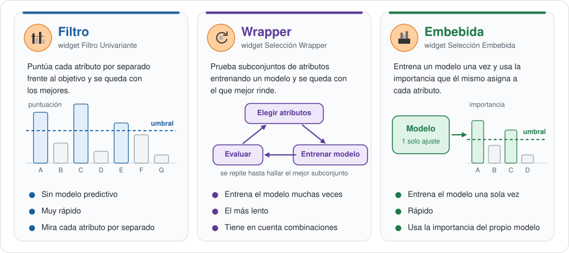
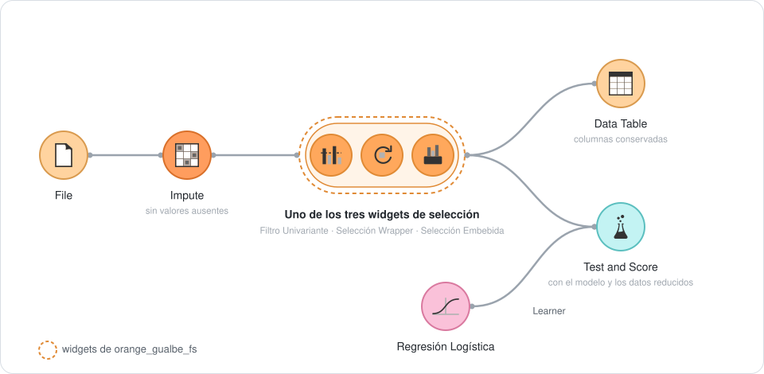
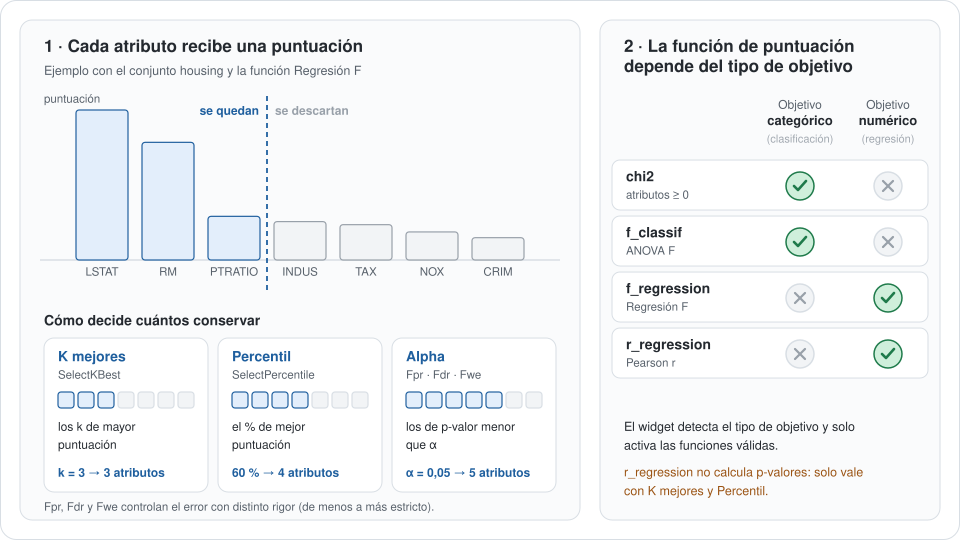
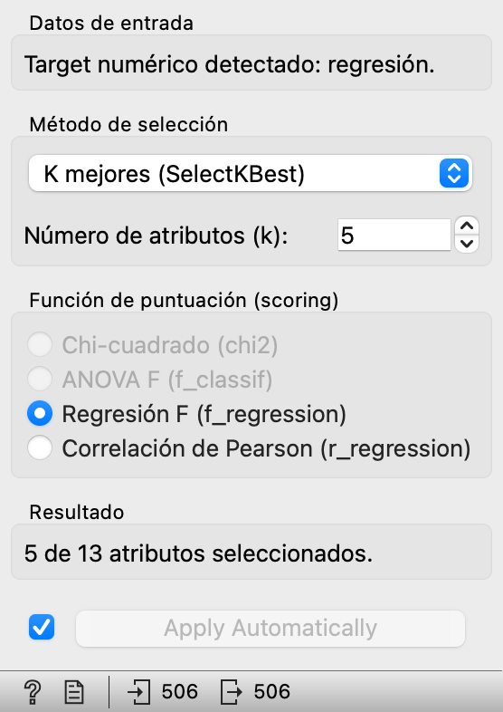
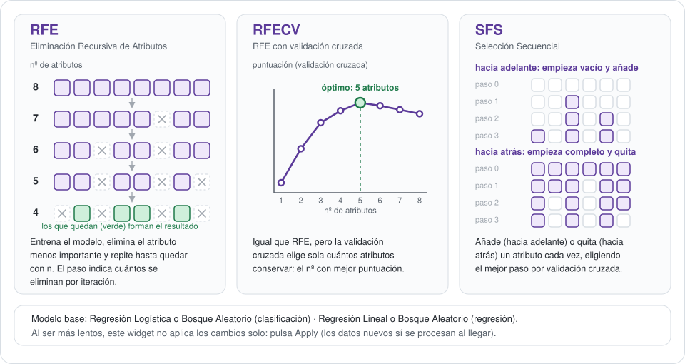
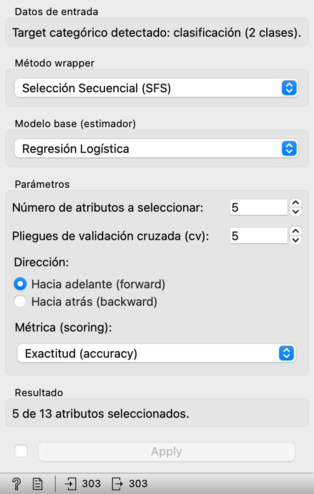
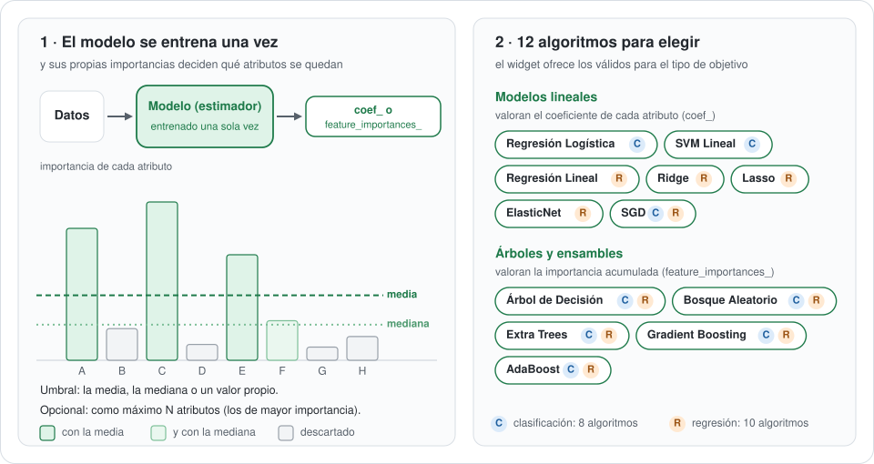
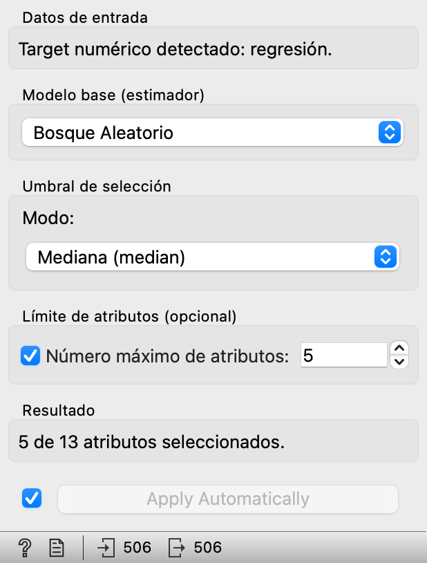

<p align="center">
  
</p>

<p align="center">
  <a href="https://pypi.org/project/orange-gualbe-fs/"></a>
  <a href="https://github.com/gualbe/orange_gualbe_fs/actions/workflows/publish.yml"></a>
  <a href="https://github.com/gualbe/orange_gualbe_fs/blob/main/LICENSE"></a>
  <a href="https://orangedatamining.com/"></a>
  <a href="https://doi.org/10.5281/zenodo.24144443"></a>
</p>

Add-on para [Orange Data Mining](https://orangedatamining.com/) que añade
la categoría **Selección de Atributos** al lienzo, con tres widgets para
quedarte solo con los atributos (columnas) más útiles de una tabla. Los
tres funcionan igual: reciben una tabla con variable objetivo, se
configuran desde su interfaz y devuelven la misma tabla reducida a los
atributos elegidos. El tipo de objetivo (categórico o numérico) se
detecta solo, y cada widget ofrece únicamente los métodos y modelos
válidos para él.

| Widget | Para qué sirve |
| --- | --- |
| **Filtro Univariante** | Puntúa cada atributo por separado y conserva los mejores: los *k* primeros, un percentil o los de p-valor bajo. No usa ningún modelo. |
| **Selección Wrapper** | Prueba subconjuntos de atributos entrenando un modelo: RFE, RFECV o selección secuencial (hacia adelante o hacia atrás). |
| **Selección Embebida** | Usa la importancia que un modelo, entrenado una sola vez, asigna a cada atributo. 12 algoritmos a elegir. |

## Instalación

Desde Orange: menú **Options → Add-ons…**, botón **Add more…**, escribe
`orange_gualbe_fs` y reinicia Orange.

O con `pip`, en el mismo entorno de Python que Orange:

```bash
pip install orange_gualbe_fs
```

## Qué familia de métodos elegir

<p align="center">
  
</p>

- **Filtro**: el punto de partida. Es muy rápido y no usa ningún modelo,
  pero valora cada atributo por separado y no ve las combinaciones.
- **Wrapper**: cuando puedes esperar y quieres el mejor subconjunto para un
  modelo concreto. Es el más lento.
- **Embebida**: un punto intermedio. Entrena el modelo una sola vez y sus
  propias importancias deciden.

## Flujo de trabajo típico

<p align="center">
  
</p>

1. **File** carga los datos. La tabla debe tener una variable objetivo.
2. **Impute** rellena los valores ausentes, porque las funciones de
   scikit-learn no los admiten.
3. Uno de los tres widgets recibe la tabla y devuelve la misma con solo
   los atributos seleccionados. Para comparar métodos, conecta la salida
   de **Impute** a varios de ellos.
4. **Data Table** muestra qué columnas se conservan. **Test and Score**,
   con un modelo en su entrada *Learner*, evalúa un modelo con los datos
   ya reducidos.

## Filtro Univariante

Puntúa cada atributo por separado frente a la variable objetivo, sin
entrenar ningún modelo, y se queda con los mejores.

<p align="center">
  
</p>

**Entradas:** *Data*. **Salidas:** *Data* (tabla reducida).

| Parámetro | Qué controla |
| --- | --- |
| Método de selección | **K mejores** (`SelectKBest`, con *k*), **Percentil** (`SelectPercentile`, con el %) o por p-valor: `SelectFpr`, `SelectFdr` y `SelectFwe`, con *alpha* (de menos a más estricto). |
| Función de puntuación | Según el objetivo: **chi2** y **ANOVA F** (`f_classif`) para clasificación; **Regresión F** (`f_regression`) y **correlación de Pearson** (`r_regression`) para regresión. El widget desactiva las que no son válidas. |

**A tener en cuenta:**

- Los cambios se aplican solos (*Apply Automatically*), porque es rápido.
- `chi2` solo admite atributos mayores o iguales que 0: normaliza antes si
  hace falta.
- `r_regression` no calcula p-valores: con `SelectFpr`, `SelectFdr` o
  `SelectFwe` el widget muestra un error y no envía salida. Úsala con *K
  mejores* o *Percentil*.
- `r_regression` puntúa **con signo**: una correlación negativa fuerte
  puntúa peor que una positiva débil. Si te interesa la fuerza de la
  relación sin importar el signo, usa `f_regression`.

<p align="center">
  
</p>

## Selección Wrapper

Prueba subconjuntos de atributos entrenando un modelo y se queda con el
que mejor rinde. Es más lento que los otros dos, pero tiene en cuenta las
combinaciones de atributos.

<p align="center">
  
</p>

**Entradas:** *Data*. **Salidas:** *Data* (tabla reducida).

| Parámetro | Métodos que lo usan | Qué controla |
| --- | --- | --- |
| Modelo base | Todos | Regresión Logística o Bosque Aleatorio (clasificación); Regresión Lineal o Bosque Aleatorio (regresión). |
| Número de atributos a seleccionar | RFE, SFS | Cuántos atributos debe conservar el resultado. |
| Paso | RFE, RFECV | Cuántos atributos se eliminan en cada iteración. |
| Mínimo de atributos a conservar | RFECV | Límite inferior de la búsqueda automática. |
| Pliegues de validación cruzada (cv) | RFECV, SFS | En cuántos grupos se divide el conjunto para evaluar cada paso. |
| Dirección | SFS | *Hacia adelante* (empieza sin atributos y añade) o *hacia atrás* (empieza con todos y quita). |
| Métrica (scoring) | RFECV, SFS | Con qué métrica se comparan los subconjuntos: la automática del modelo, exactitud, F1 macro o exactitud balanceada (clasificación); R², error cuadrático medio o error absoluto medio (regresión). |

**A tener en cuenta:**

- Los métodos wrapper pueden tardar con muchos atributos o muchos datos,
  sobre todo RFECV y SFS hacia atrás. Por eso este widget **no aplica los
  cambios solo**: pulsa **Apply** tras ajustar los parámetros. Los datos
  nuevos sí se procesan al llegar.

<p align="center">
  
</p>

## Selección Embebida

Entrena un modelo una sola vez y usa la importancia (o el coeficiente)
que él mismo asigna a cada atributo (`SelectFromModel`).

<p align="center">
  
</p>

**Entradas:** *Data*. **Salidas:** *Data* (tabla reducida).

| Parámetro | Qué controla |
| --- | --- |
| Modelo base | Según el objetivo: 8 algoritmos de clasificación y 10 de regresión. Los modelos lineales (Regresión Logística o Lineal, SVM Lineal, Ridge, Lasso, ElasticNet, SGD) valoran el coeficiente de cada atributo; los árboles y ensambles (Árbol de Decisión, Bosque Aleatorio, Extra Trees, Gradient Boosting, AdaBoost), su importancia acumulada. |
| Umbral | **Media**, **mediana** o un **valor personalizado**: se conservan los atributos cuya importancia lo supera. |
| Límite de atributos | Opcional: número máximo de atributos a conservar, aunque el umbral deje pasar más. |

**A tener en cuenta:**

- Los cambios se aplican solos (*Apply Automatically*), porque solo se
  ajusta un modelo.
- Con un umbral muy alto puede no quedar ningún atributo: el widget avisa
  en lugar de fallar.

<p align="center">
  
</p>

## Requisitos de los datos de entrada

- La tabla debe tener una variable objetivo (target) definida.
- Si vas a usar `chi2`, todos los atributos deben ser no negativos (aplica
  antes una normalización si es necesario).
- Si los datos tienen valores ausentes, imputa antes con el widget
  **Impute** de Orange: las funciones de puntuación de scikit-learn no
  admiten valores faltantes.

## Ayuda dentro de Orange

Selecciona un widget en el lienzo y pulsa **F1**, o el icono **?** de su
barra de estado, para abrir su documentación en castellano.

## Desarrollo

```bash
git clone https://github.com/gualbe/orange_gualbe_fs.git
cd orange_gualbe_fs
python -m venv .venv && source .venv/bin/activate
pip install Orange3 PyQt5 sphinx
pip install -e .
python -m Orange.canvas
```

**Ayuda (F1).** Se genera con [Sphinx](https://www.sphinx-doc.org/) desde
`doc/`, dentro del propio paquete, para que funcione también instalada
desde PyPI:

```bash
python -m sphinx -b html doc orangecontrib/orange_gualbe_fs/_help/html
```

Cada widget tiene su página `doc/widgets/<nombre>.rst`, que empieza con
una etiqueta igual al nombre del widget en minúsculas (por ejemplo,
`.. _filtro univariante:`). Así la encuentra Orange. La carpeta `_help/`
es generada y no se versiona. El workflow de publicación la reconstruye en
cada release.

**Imágenes de este README.** Están en `assets/` y se regeneran con:

```bash
python assets/generar_imagenes.py --capturas
```

## Mantenimiento y publicación en PyPI

Este repositorio es la **fuente de verdad** del add-on: todo cambio se
hace aquí (commit y `git push` a `main`), y cada versión publicada en
[PyPI](https://pypi.org/project/orange-gualbe-fs/) corresponde a un estado
de `main` cuyo `version` en `pyproject.toml` es el mismo número.

La publicación en PyPI es automática mediante
[Trusted Publishing](https://docs.pypi.org/trusted-publishers/). Al
publicar una release en GitHub, el workflow
`.github/workflows/publish.yml` genera la ayuda, construye el paquete,
lo sube a PyPI sin tokens y adjunta los ficheros a la release. Así
GitHub y PyPI no pueden quedar desincronizados.

1. Sube `version` en `pyproject.toml` y haz commit y push a `main`.
2. Crea la release con una etiqueta `v` + la misma versión:

   ```bash
   gh release create vX.Y.Z --title "vX.Y.Z" --notes "Cambios de esta versión"
   ```

El workflow rechaza la publicación si la etiqueta no coincide con la
versión de `pyproject.toml`. Para validar la construcción sin publicar,
lánzalo a mano desde la pestaña *Actions* o con
`gh workflow run publish.yml`.

Como plan B, si GitHub Actions no estuviera disponible, se puede construir
(`python -m build`, tras regenerar la ayuda como se explica arriba) y
subir a mano con `twine upload dist/*`.

## Licencia y autoría

**Autor:** Gualberto Asencio Cortés · Copyright © 2026.

`orange_gualbe_fs` es software libre bajo la licencia
[GPL-3.0-or-later](https://github.com/gualbe/orange_gualbe_fs/blob/main/LICENSE)
(GNU GPL versión 3 o posterior), la misma familia de licencia que Orange, del que
el add-on importa y hereda clases.

Además, al amparo del artículo 7 de la GPL-3, el fichero
[`NOTICE`](https://github.com/gualbe/orange_gualbe_fs/blob/main/NOTICE) añade
unos términos adicionales que se aplican al material del autor:

- **Atribución (7 b):** toda copia o versión modificada, completa o parcial, debe
  conservar el aviso de copyright y la atribución de autoría a Gualberto Asencio
  Cortés en los ficheros fuente, en la documentación y en `NOTICE`.
- **Origen y versiones modificadas (7 c):** no se puede falsear el origen del
  material; las versiones modificadas deben marcarse como distintas del original
  y no pueden presentarse como el add-on original ni como publicadas o
  respaldadas por su autor.
- **Nombres (7 e):** no se concede ningún derecho sobre los nombres
  «orange_gualbe», «Orange Gualbe» ni «Gualbe».

**Forks y versiones derivadas.** Puedes estudiar, modificar y redistribuir el
código en los términos de la GPL-3, pero si distribuyes una versión modificada
debes publicarla con otro nombre de paquete y de proyecto (que no contenga esos
nombres), indicar que es una versión modificada de `orange_gualbe_fs` y no
presentarla como oficial ni como obra del autor.

**Cómo citar.** Cita el add-on con su DOI general de Zenodo,
[10.5281/zenodo.24144443](https://doi.org/10.5281/zenodo.24144443), que remite siempre a la última versión (cada
release tiene además su propio DOI en Zenodo). Si usas el add-on en un trabajo
académico, puedes tomar los metadatos de
[`CITATION.cff`](https://github.com/gualbe/orange_gualbe_fs/blob/main/CITATION.cff)
(GitHub ofrece «Cite this repository» con el formato APA o BibTeX), por ejemplo:

> Asencio Cortés, G. (2026). *orange_gualbe_fs: add-on de selección de atributos
> para Orange Data Mining* (versión 0.1.5) [Software]. Zenodo.
> https://doi.org/10.5281/zenodo.24144443

**Componentes de terceros.** El add-on depende de Orange Data Mining (GPL-3.0 o
posterior, Bioinformatics Laboratory, Universidad de Liubliana) y de
scikit-learn (BSD-3-Clause), que se instalan aparte. Los iconos de Orange que
aparecen en los esquemas de este README pertenecen a sus autores y se
distribuyen bajo GPL-3.0 o posterior como parte de Orange. No se ha copiado
código de Orange ni de otros proyectos.
